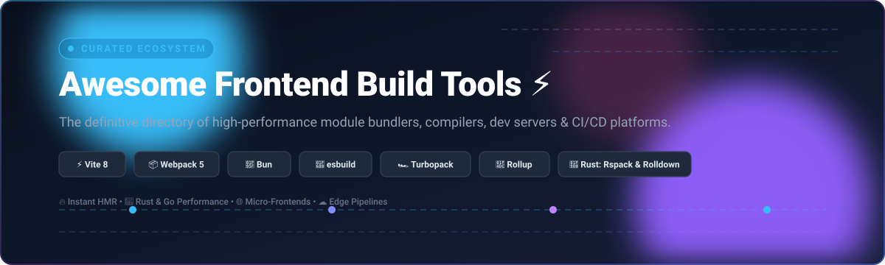

# ⚡ Awesome Frontend Build Tools

**A curated index of top-tier frontend build tools, next-generation bundlers, ultra-fast compilers, dev servers, and cloud build platforms.**

*Comprehensive insights into module bundling, Hot Module Replacement (HMR), Rust/Go toolchains, tree-shaking, and enterprise CI/CD orchestration.*

---

## 📑 Table of Contents

- [🌐 Sector Overview & Market Dynamics](#-sector-overview--market-dynamics)
- [☁️ SaaS & Hosted Build Platforms](#️-saas--hosted-build-platforms)
- [📦 Open-Source GitHub Projects](#-open-source-github-projects)
  - [⭐ Ranked by GitHub Stars](#-ranked-by-github-stars)
  - [🏛️ Historical & Discontinued Tools](#️-historical--discontinued-tools)
- [🧭 Decision Matrix & Tool Selection](#-decision-matrix--tool-selection)
- [🤝 How to Contribute](#-how-to-contribute)
- [⚖️ Disclaimer & License](#️-disclaimer--license)

---

## 🌐 Sector Overview & Market Dynamics

The global frontend build tooling, web development infrastructure, and edge deployment platform sector is estimated at **$18.5 Billion** (projected to exceed $45 Billion by 2032 with an ~18.8% CAGR), propelled by escalating web application complexity, TypeScript adoption, and micro-frontend architectures. 

The sector exhibits a **bifurcated market structure**:
- **Hosting & Cloud Orchestration (Concentrated)**: Moderately concentrated with high winner-take-most dynamics dominated by hyperscalers and edge platforms (Microsoft/GitHub, Amazon AWS, Cloudflare, and Vercel) that monetize compute, serverless invocations, and global edge CDNs.
- **Open-Source Bundler & Compiler Engines (Highly Fragmented & Shifting)**: Highly fragmented and intensely competitive. While legacy giants like Webpack still power the majority of enterprise production codebases (~84% historical footprint), a massive architectural migration toward native-code compilers (Rust, Go, Zig) led by Vite, Turbopack, esbuild, SWC, Rspack, and Rolldown is redefining baseline developer experience with sub-second builds and instant HMR.

---

## ☁️ SaaS & Hosted Build Platforms

The table below outlines leading commercial SaaS solutions and hosted pipeline platforms powering continuous integration, automated frontend builds, and instant global deployments. Sorted by **Company Valuation / Revenue (Descending)**.

| Platform / Service | Primary Capabilities & Toolchain Integration | Starting Tier Pricing | Free Tier Limits | Company Valuation / Revenue |
| :--- | :--- | :--- | :--- | :--- |
| **[GitHub Actions](https://github.com/features/actions)** | Native CI/CD orchestration; cloud runner environments for Vite, Webpack, Rollup, and Dockerized multi-stage asset workflows. | **$4.00 / user / month** *(GitHub Team)* | **2,000 build mins / month** (private repos; unlimited for public), 500 MB package storage, 1 concurrent Windows/macOS runner | **$3.1 Trillion** *(Microsoft Valuation / ~$1B+ GitHub ARR)* |
| **[AWS Amplify](https://aws.amazon.com/amplify/)** | Fullstack web hosting & git-driven continuous delivery for Next.js, Vite, and React with serverless backend integrations. | **$0.01 / build minute** *(Pay-as-you-go; + $0.023/GB storage)* | **1,000 build mins / month** for 12 months, 5 GB storage, 15 GB bandwidth served / month | **$2.1 Trillion** *(Amazon Valuation / $105B+ AWS ARR)* |
| **[Cloudflare Pages](https://pages.cloudflare.com/)** | Edge-native static & JAMstack hosting with automatic Git builds for Vite, Webpack, and Astro across Cloudflare's global anycast network. | **$5.00 / month** *(Cloudflare Workers / Pages Paid)* | **500 builds / month**, 1 concurrent build, unlimited bandwidth, unlimited preview URLs, 100 custom domains | **$32 Billion** *(NYSE: NET Market Cap / ~$1.6B ARR)* |
| **[Vercel](https://vercel.com/)** | Frontend cloud platform providing first-class Turbopack & Next.js integration, incremental compilation, and edge compute delivery. | **$20.00 / user / month** *(Vercel Pro)* | **6,000 build mins / month**, 1 concurrent build, 100 GB bandwidth / month, non-commercial personal projects only | **$3.25 Billion** *(Series E Valuation / ~$100M+ ARR)* |
| **[Netlify](https://www.netlify.com/)** | Composable web platform offering automated continuous deployments, build caching plugins for Vite/Webpack, and edge routing. | **$19.00 / member / month** *(Netlify Pro, billed annually)* | **300 build mins / month**, 1 concurrent build, 100 GB bandwidth / month, 100 form submissions / month | **$2.0 Billion** *(Series D Valuation / ~$60M+ ARR)* |

---

## 📦 Open-Source GitHub Projects

Explore the leading open-source frontend build engines, bundlers, and compilation ecosystems.

### ⭐ Ranked by GitHub Stars

Sorted strictly in descending order of GitHub community stars.

1. **[Bun](https://github.com/oven-sh/bun)**   
   🚀 *All-in-one JavaScript runtime, native bundler, transpiler, and package manager written in Zig.*  
   Bun provides an integrated standalone bundler (`bun build`) with extreme speed, parsing and packaging JavaScript, TypeScript, and JSX without requiring external compilation steps. Best for zero-setup execution, ultra-fast script bundling, and server-side SSR packaging.  
   `License: MIT`

2. **[Vite](https://github.com/vitejs/vite)**   
   ⚡ *Next-generation frontend tooling offering instant dev server start and lightning-fast HMR.*  
   Vite powers the vast majority of modern Vue, React, and Svelte applications. **Architecture Update**: Vite 8 transitions its core production engine to **Rolldown** (Rust-based bundler), consolidating the historical dual-bundler split (esbuild dev + Rollup prod) into a unified, high-performance pipeline with 10–30x build speed gains.  
   `License: MIT`

3. **[Webpack](https://github.com/webpack/webpack)**   
   📦 *The foundational enterprise module bundler with an unmatched loader and plugin ecosystem.*  
   Webpack remains the battle-tested backbone of enterprise software with deep support for Module Federation (micro-frontends), advanced code-splitting, asset pipelines, and legacy browser shims. The roadmap targets native HTML entry points, unified minification, and runtime-agnostic execution across Node, Deno, and Bun.  
   `License: MIT`

4. **[Babel](https://github.com/babel/babel)**   
   🔄 *The compiler for next-generation ECMAScript and JSX transpilation.*  
   Babel revolutionized JavaScript by enabling developers to use modern language syntax and experimental TC39 proposals through transform plugins and polyfill strategies (`core-js`). While native compilers (SWC/esbuild) now handle standard compilation, Babel remains indispensable for complex custom AST transformations and macro pipelines.  
   `License: MIT`

5. **[Parcel](https://github.com/parcel-bundler/parcel)**   
   🎁 *Zero-configuration build tool and bundler for web applications.*  
   Parcel handles HTML, CSS, JavaScript, WebAssembly, images, and fonts automatically without configuration boilerplate. Powered by a Rust-based compiler engine (SWC) and multi-threaded architecture, Parcel excels at rapid prototyping, educational projects, and greenfield applications.  
   `License: MIT`

6. **[esbuild](https://github.com/evanw/esbuild)**   
   🏎️ *An extremely fast Go-based JavaScript/TypeScript bundler and minifier.*  
   Written from scratch in Go with parallelized parsing and code-generation, esbuild redefined ecosystem speed expectations (10x–100x faster than legacy bundlers). It serves as critical infrastructure powering dependency pre-bundling in Vite, `tsup`, `tsx`, and cloud serverless packagers.  
   `License: MIT`

7. **[SWC](https://github.com/swc-project/swc)**   
   🦀 *Rust-based platform for the web providing ultra-fast compilation and bundling.*  
   SWC (Speedy Web Compiler) offers a 20x speedup over Babel on single-thread execution and 70x on multi-core architectures. It serves as the primary code-transformation engine underpinning Next.js, Parcel, and Deno.  
   `License: Apache-2.0`

8. **[Gulp](https://github.com/gulpjs/gulp)**   
   🌊 *Streaming task runner leveraging Node.js streams for file transformation workflows.*  
   Gulp excels at programmatic multi-step pipelines: optimizing SVG sprite atlases, compiling legacy Sass stylesheets, processing static documentation, and orchestrating deployment steps where pure module bundlers are unsuitable.  
   `License: MIT`

9. **[Turbopack](https://github.com/vercel/turbo)**   
   ⚡ *Incremental Rust bundler designed as the successor to Webpack by Vercel.*  
   Turbopack uses the Turbo engine for function-level caching and incremental computation. Built into Next.js as the default development bundler, it provides near-instant HMR updates that scale independently of application size.  
   `License: MIT`

10. **[Rollup](https://github.com/rollup/rollup)**   
    📜 *The standard module bundler for JavaScript libraries and ES modules.*  
    Rollup popularized static tree-shaking and produces clean, minimalist ESM/CJS bundles. It remains the default choice for publishing npm packages and authored the plugin architecture that serves as the blueprint for Vite and Rolldown.  
    `License: MIT`

11. **[Biome](https://github.com/biomejs/biome)**   
    🌿 *High-performance Rust toolchain for formatting, linting, and web asset orchestration.*  
    Born as a fork of Rome, Biome is a single binary that unifies formatting (Prettier alternative) and linting (ESLint alternative) with 25x–35x speed improvements. While primarily a linter/formatter today, its AST compiler foundation is expanding toward complete toolchain unification.  
    `License: MIT / Apache-2.0`

12. **[Browserify](https://github.com/browserify/browserify)**   
    🌐 *The pioneer that enabled Node.js-style `require()` modules in browser runtimes.*  
    Browserify introduced module packaging to modern web development by bundling CommonJS code and polyfilling Node core modules. Maintained for backward compatibility and legacy systems.  
    `License: MIT`

13. **[Rolldown](https://github.com/rolldown/rolldown)**   
    ⚙️ *Fast Rust-based bundler with Rollup-compatible plugin APIs, designed as the core engine for Vite.*  
    Developed under the VoidZero and Vite organization, Rolldown combines the raw speed of esbuild with Rollup's advanced code-splitting and plugin API compatibility, unifying the future of web bundling.  
    `License: MIT`

14. **[Rspack](https://github.com/web-infra-dev/rspack)**   
    🦀 *High-performance Rust bundler designed as a drop-in replacement for Webpack.*  
    Engineered by ByteDance's Web Infra team, Rspack offers 5x–10x faster cold builds and instant HMR while maintaining seamless compatibility with existing Webpack plugins, loaders, and Module Federation configs.  
    `License: Apache-2.0`

15. **[Grunt](https://github.com/gruntjs/grunt)**   
    🛠️ *The early JavaScript task runner with file-based configuration.*  
    Grunt pioneered automated frontend workflows in the pre-Webpack era. Preserved for historical reference and legacy enterprise maintenance.  
    `License: MIT`

16. **[tsup](https://github.com/egoist/tsup)**   
    📦 *Zero-config TypeScript library bundler powered under the hood by esbuild.*  
    Enables developers to bundle `.ts`, `.tsx`, and modern JS into dual CJS/ESM formats with automatic `.d.ts` declaration generation without writing complex configuration files.  
    `License: MIT`

17. **[Farm](https://github.com/farm-fe/farm)**   
    🚜 *Extremely fast Rust-based web building engine with partial bundling architecture.*  
    Farm solves the trade-off between excessive network requests (unbundled dev servers) and heavy compilation overhead by breaking modules into fine-grained partial bundles during both development and production.  
    `License: MIT`

---

### 🏛️ Historical & Discontinued Tools

- **[Snowpack](https://github.com/FredKSchott/snowpack)** — Pioneered no-bundle ESM development servers; officially retired in favor of Vite.
- **[WMR](https://github.com/preactjs/wmr)** — Preact's dedicated unbundled development server and bundler; deprecated with the Preact team officially recommending Vite.

---

## 🧭 Decision Matrix & Tool Selection

| Use Case / Scenario | Recommended Primary Tool | Alternative / Secondary | Why This Selection? |
| :--- | :--- | :--- | :--- |
| **New Web Application** (React, Vue, Svelte) | **Vite** | **Bun / Parcel** | Instant HMR, rich plugin ecosystem, now backed by Rust-powered Rolldown. |
| **Fullstack Next.js App** | **Turbopack** | **Webpack** | Built directly into Next.js with incremental compilation caching. |
| **Publishing NPM Libraries** | **tsup / Rollup** | **Bun** | Generates cleanest ESM/CJS exports and automated TypeScript declaration types. |
| **Large Legacy Webpack Migration** | **Rspack** | **Vite** | 5x–10x build speed acceleration with near-zero Webpack configuration rewrites. |
| **Raw Compilation & Script Bundling** | **esbuild** | **SWC / Bun** | Instantaneous parsing and bundling speed written in Go and Zig. |
| **Multi-Asset File Pipelines** (SVGs, Fonts) | **Gulp** | **npm scripts** | Stream-based file piping for non-JS static assets. |

---

## 🤝 How to Contribute

Contributions are welcome! Help keep this curated list accurate and up to date:

1. 🍴 **Fork the repository**.
2. 🌿 **Create a new branch**: `git checkout -b feature/add-new-tool`.
3. 📝 **Add or update entries**: Follow the established formatting (include links, star count badge, licensing, and specific pricing/limits for SaaS).
4. 🚀 **Submit a Pull Request** with a concise explanation of your additions.

---

## ⚖️ Disclaimer & License

- This repository is a **community-curated guide** intended for informational and educational purposes. Mentions do not imply commercial endorsement.
- All product names, logos, and brands are property of their respective owners.
- Code & content distributed under the [MIT License](LICENSE).
